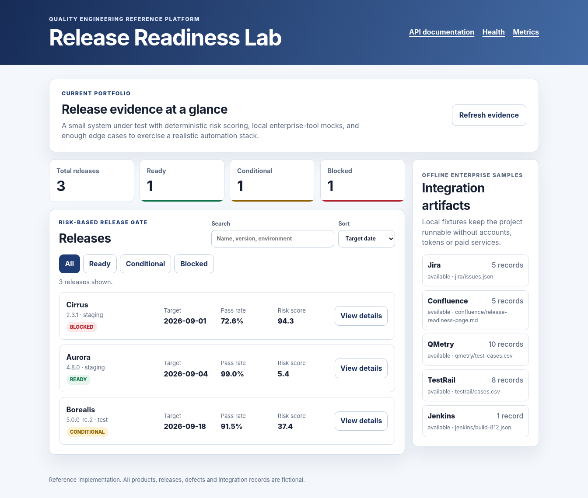

# Quality Engineering Reference Platform

A runnable release-readiness system plus the test assets I would expect around it on a real product: API and UI automation, risk-based release gates, SQL checks, enterprise-tool import samples, CI pipelines, service virtualization, performance work, security checks, observability and deployment examples.

The application is called **Release Readiness Lab**. It has three fictional releases with deliberately different outcomes: one ready, one conditional and one blocked. That keeps the examples useful without connecting to Jira, Confluence, QMetry, TestRail, Jenkins or any paid service.



## Run it

Node.js 22 is the only requirement for the checked-in build.

```bash
node dist/server.js
```

Open `http://127.0.0.1:4173`.

The server has no runtime packages. The TypeScript source is compiled into `dist/`, so the dashboard and API work before any dependency install.

To rebuild the source and use the extended JavaScript test tools:

```bash
npm install
npm run build
npm test
```

Independent Python checks:

```bash
python -m venv .venv
# Windows: .venv\Scripts\activate
# Linux/macOS: source .venv/bin/activate
python -m pip install -r requirements-dev.txt
pytest -m "not browser"
```

Docker is optional:

```bash
docker compose up --build app
```

## What is in the repository

| Area | Examples |
|---|---|
| Product under test | TypeScript/Node REST API, accessible dashboard, deterministic risk model, XML endpoint, Prometheus metrics |
| API testing | OpenAPI 3.1, Postman/Newman, pytest + Requests, Node integration tests, negative and boundary cases |
| Browser testing | Playwright, Cypress, Selenium, accessibility scan with axe, visual baseline |
| BDD | Cucumber feature and executable release-gate scenarios |
| Enterprise workflow samples | Jira JSON, Confluence page, QMetry CSV/JUnit, TestRail CSV, Jenkins build record |
| Data | PostgreSQL schema, seed data, analytical query and zero-row data-quality assertions |
| Performance | k6 smoke/load models, JMeter plan, Lighthouse CI budgets |
| Security | ZAP automation, Semgrep rules, gitleaks configuration, threat model, Trivy workflow |
| Delivery | GitHub Actions, Jenkinsfile, Docker, Kubernetes manifests and Helm chart |
| Test environment | WireMock stubs for success, timeout and inventory scenarios |
| Diagnostics | Request IDs, Prometheus/Grafana assets, Wireshark/tshark filters and capture helpers |

The detailed map is in [`docs/tooling-matrix.md`](docs/tooling-matrix.md).

## Core commands

```bash
node dist/server.js                 # start the application
node scripts/validate-project.mjs   # validate fixtures and repository structure
node --test tests/node/*.test.js    # unit, API and contract checks
pytest -m "not browser"             # independent API and data checks
npm run test:playwright             # Chromium + Firefox UI checks
npm run test:cypress                # Starts the app and runs the Cypress sample
npm run test:cucumber               # BDD examples
npm run test:postman                # Starts the app and runs the Newman collection
npm run test:lighthouse             # Lighthouse budgets and local HTML evidence
```

`reports/samples/` contains small checked-in evidence examples. Fresh CI output belongs in the ignored `reports/generated/` directory.

## API surface

- `GET /api/health`
- `GET /api/releases`
- `GET /api/releases/{id}`
- `POST /api/releases/{id}/evaluate`
- `GET /api/integrations`
- `POST /soap/release-readiness`
- `GET /metrics`
- `GET /openapi.yaml`

The local API documentation page is at `/api-docs.html`.

## Design notes

The project keeps the system under test deliberately small. The point is not to bury the quality work under a large product codebase; it is to make test intent, risk decisions and evidence easy to review.

A few choices are intentional:

- The default run has no account, token, database or cloud dependency.
- Enterprise records are import-shaped fixtures, not screenshots pretending to be integrations.
- The release gate is deterministic and unit tested at its decision boundaries.
- The UI is useful enough for realistic browser, accessibility and visual checks.
- Optional tools are separated from the core path so a missing Docker daemon or browser package does not make the repository unusable.
- All company names, products, defects, people and release decisions are fictional.

## Suggested review path

1. Start the app and filter the three release states.
2. Read `src/risk.ts` and the matching unit/BDD cases.
3. Compare the OpenAPI contract with Node, Python and Postman checks.
4. Open `docs/test-strategy.md` and `docs/traceability-matrix.md`.
5. Browse the Jira/QMetry/TestRail/Jenkins samples under `data/integrations/`.
6. Review the CI, performance, security and Kubernetes assets as supporting work rather than decoration.

## Repository status

The core build, repository validator, Node test suite and non-browser pytest suite are expected to pass locally. Browser, ZAP, k6, Lighthouse, Docker and Kubernetes paths are available when their corresponding free tools are installed.

Licensed under the MIT License.
